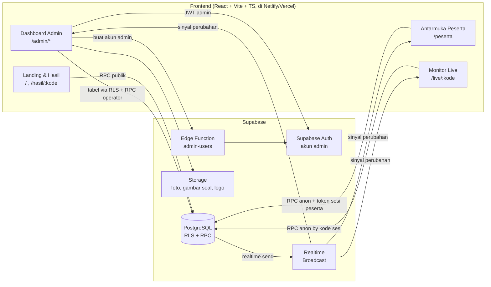
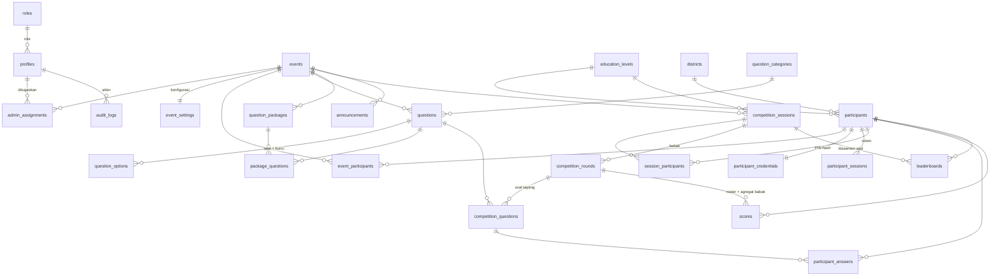
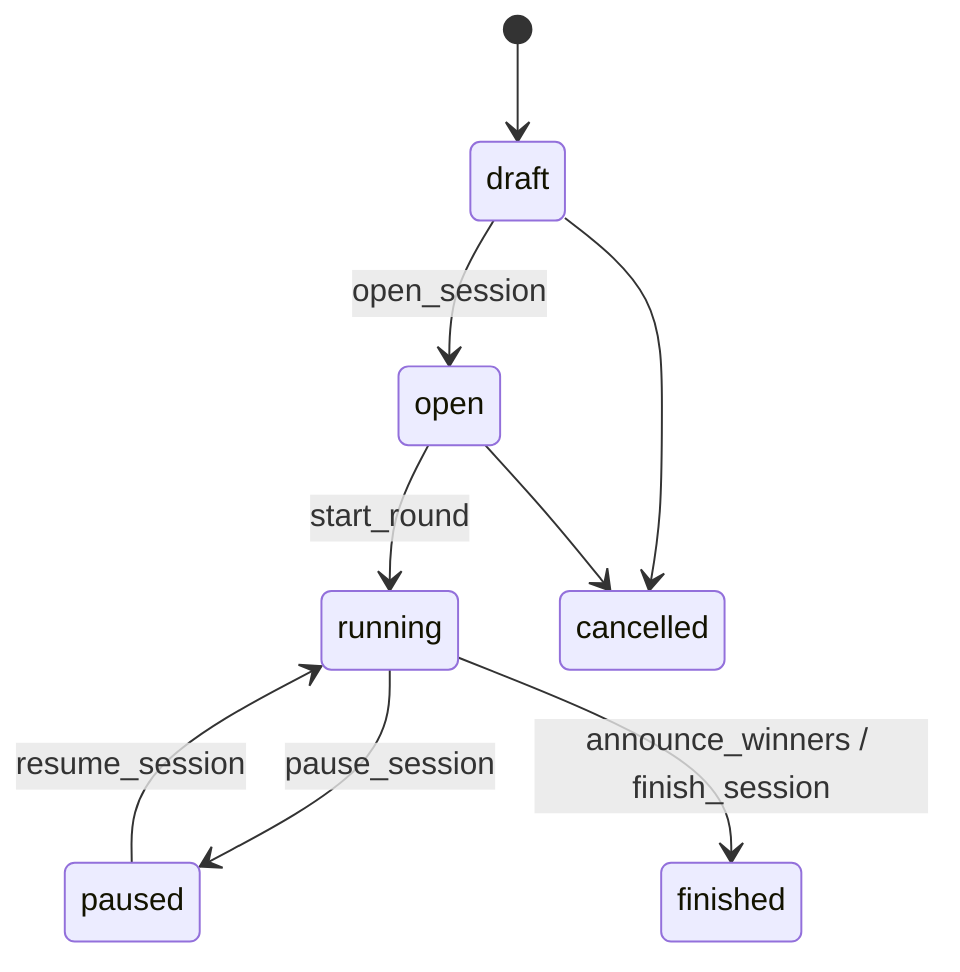

# Arsitektur Sistem — Lomba Rangking 1

> Produk UPT SMPN 1 Baradatu · Dikembangkan oleh Dodi Sujatmiko
> "Siapa Cepat, Siapa Tepat, Dialah Juara!"

Dokumen ini adalah hasil **Tahap 1**: analisis kebutuhan, arsitektur, ERD, alur sistem, dan asumsi teknis.

## 1. Ringkasan kebutuhan

| Aktor | Perangkat | Kebutuhan inti |
|---|---|---|
| Superadmin | Laptop | Kontrol penuh: admin, event, master data, pengaturan global, audit |
| Admin / Operator | Laptop | Mengelola peserta & soal pada event yang ditugaskan, mengontrol pertandingan |
| Peserta (≥135) | HP masing-masing | Login kode + PIN, menjawab soal, melihat status & hasil |
| Monitor | TV / proyektor 16:9 | Menampilkan soal, countdown, leaderboard, podium — tanpa login |

Kebutuhan non-fungsional utama: skor **tidak boleh** dihitung di browser, satu jawaban per peserta per soal,
waktu berasal dari server, kunci jawaban tidak pernah keluar dari server selama soal aktif, dan sistem
tetap benar saat 135 peserta mengirim jawaban pada detik yang sama.

## 2. Arsitektur



### Prinsip keputusan

1. **Database sebagai otoritas.** Seluruh logika kritis (login peserta, submit jawaban, skor, eliminasi,
   ranking, transisi status pertandingan) berada di fungsi PostgreSQL `SECURITY DEFINER`. Frontend hanya
   memanggil RPC dan menampilkan hasil.
2. **Peserta tidak memakai Supabase Auth.** Peserta login lewat RPC `participant_login(kode, pin)`.
   PIN disimpan sebagai hash bcrypt (`pgcrypto`), sesi berupa token acak 256-bit yang hanya disimpan
   hash SHA-256-nya di server. Role `anon` **tidak punya akses SELECT** ke tabel sensitif mana pun;
   seluruh data peserta keluar lewat RPC yang menyaring kolom.
3. **Realtime = sinyal, bukan sumber kebenaran.** Trigger database mengirim *broadcast* kecil ke topik
   `live:<kode sesi>`. Klien yang menerima sinyal mengambil *snapshot* resmi lewat RPC. Jika websocket
   putus, klien otomatis berpindah ke polling dan mengambil snapshot ulang saat tersambung kembali.
   Dengan pola ini tidak ada state yang hilang karena pesan realtime terlewat.
4. **Waktu server.** Setiap snapshot menyertakan `server_now`. Klien menghitung selisih jam lalu
   menampilkan countdown dari `started_at` dan `deadline_at`. Timer browser hanya untuk tampilan;
   validasi deadline dilakukan server saat jawaban diterima.
5. **Penguncian kolom mesin lomba.** Kolom status/waktu pada sesi, babak, dan soal dilindungi trigger:
   klien (role `authenticated`) tidak bisa mengubahnya langsung — hanya lewat RPC operator yang
   memvalidasi transisi status.

## 3. Role & hak akses (RBAC)

| Kemampuan | Superadmin | Admin (per event, sesuai izin) | Peserta | Publik |
|---|:-:|:-:|:-:|:-:|
| Kelola admin, hak akses, pengaturan global, audit penuh | ✔ | – | – | – |
| Buat / hapus event, kelola kecamatan & jenjang | ✔ | – | – | – |
| Kelola peserta event (`can_manage_participants`) | ✔ | ✔ | – | – |
| Kelola soal & paket (`can_manage_questions`) | ✔ | ✔ | – | – |
| Siapkan & kontrol sesi (`can_control_competition`) | ✔ | ✔ | – | – |
| Lihat hasil & laporan (`can_view_reports`) | ✔ | ✔ | – | – |
| Menjawab soal | – | – | ✔ | – |
| Lihat monitor & hasil yang dipublikasikan | ✔ | ✔ | ✔ | ✔ |

Diterapkan dengan fungsi `is_superadmin()`, `can_access_event()`, `has_event_permission()` yang dipakai
di semua kebijakan RLS dan semua RPC operator.

## 4. ERD



Tabel pendukung di luar 24 tabel wajib: `participant_sessions` (token sesi peserta),
`rate_limits` (pembatas laju), dan `app_settings` (pengaturan global).

### Peran tiap tabel hasil

| Tabel | Isi | Ditulis oleh |
|---|---|---|
| `participant_answers` | Satu baris per (soal tayang, peserta): jawaban, benar/salah, waktu respons, poin | hanya RPC `submit_answer` |
| `scores` | Roster babak + agregat per (babak, peserta): poin, benar, salah, kosong, status eliminasi | hanya fungsi mesin lomba |
| `leaderboards` | Klasemen per (sesi, peserta) + `rank` yang ditetapkan backend + hasil tie-breaker | hanya fungsi mesin lomba |

Tidak ada kebijakan RLS INSERT/UPDATE/DELETE untuk ketiga tabel ini — admin pun hanya bisa membaca.

## 5. Mesin lomba

### 5.1 Status



Soal tayang: `pending → active → closed → revealed`, atau `→ cancelled` (skor dibatalkan & dihitung ulang).

### 5.2 Tujuh layar monitor

| Layar | Kondisi |
|---|---|
| Waiting | sesi `draft/open`, atau belum ada soal tayang |
| Countdown | soal `active`, waktu server < `started_at` (hitung mundur 3-2-1) |
| Question | soal `active`, `started_at` ≤ waktu < `deadline_at` |
| Answer Processing | waktu habis / soal `closed`, jawaban belum dibuka |
| Answer Result | soal `revealed` |
| Leaderboard | operator memilih tampilan leaderboard |
| Winner Podium | pemenang diumumkan |

### 5.3 Rumus skor

```
skor = skor_dasar + bonus_kecepatan × (sisa_waktu / total_waktu)      (hanya bila benar)
skor = −penalti                                                        (bila salah, default 0)
```

Default: dasar 100, bonus 50, durasi 20 detik, pembulatan 2 desimal. Benar pada detik ke-2 → 145;
detik ke-10 → 125; detik ke-18 → 105. Dihitung oleh fungsi SQL `calculate_score` dengan presisi milidetik.
Konfigurasi disimpan per event (`event_settings`) dan disalin/di-override per babak (`competition_rounds`).

### 5.4 Transaksi submit jawaban (atomik)

`submit_answer(token, competition_question_id, option_id, answer_text, idempotency_key)`:

1. catat `clock_timestamp()` server → 2. validasi token sesi peserta → 3. batasi laju →
4. kunci baris soal `FOR SHARE` (penutupan soal menunggu submit yang sedang berjalan) →
5. validasi status sesi & soal, `started_at ≤ now ≤ deadline_at` → 6. kunci baris roster `scores`
`FOR UPDATE` (peserta terdaftar & tidak tereliminasi) → 7. cek jawaban ganda / replay idempotency →
8. cek kunci (normalisasi jawaban singkat di server) → 9. hitung skor → 10. `INSERT` jawaban
(dijaga `UNIQUE (competition_question_id, participant_id)`) → 11. perbarui `scores` & `leaderboards` →
12. kirim sinyal progres. Dua request bersamaan untuk peserta + soal yang sama tidak mungkin
menghasilkan dua jawaban sah: kunci baris menyerikan keduanya dan constraint unik menjadi jaring terakhir.

Peserta **tidak** diberi tahu benar/salah saat mengirim — hanya "jawaban terkirim". Hasil baru terlihat
setelah operator membuka jawaban, sehingga jawaban tidak bisa bocor ke peserta lain selama soal aktif.

### 5.5 Mode babak

| Mode | Perilaku |
|---|---|
| `normal` | Semua menjawab, skor kecepatan + ketepatan |
| `speed` | Sama, tetapi urutan ranking mendahulukan waktu respons setelah poin |
| `elimination` | Aturan: `wrong_count` (N kesalahan), `score_threshold` (ambang skor), atau `manual` (keputusan operator, tercatat di audit) |
| `final` | Roster finalis dari Top-N atau pilihan manual (tercatat audit); skor dapat direset |
| `tiebreak` | Soal tambahan untuk peserta seri; poin masuk kolom tie-breaker, tidak mengubah total |

### 5.6 Urutan ranking (ditentukan backend)

1. finalis di atas non-finalis (bila babak final sudah berjalan), 2. total poin, 3. jumlah benar,
4. total waktu respons jawaban benar terkecil, 5. poin soal tambahan, 6. waktu soal tambahan.
Pada mode `speed`, butir 3 dan 4 ditukar. Fungsi `_leaderboard_ranked()` adalah satu-satunya sumber urutan.

## 6. Keamanan

| Ancaman | Mitigasi |
|---|---|
| Peserta membaca kunci jawaban | `anon` tanpa akses tabel soal; RPC hanya mengirim teks soal & opsi; kunci dikirim setelah status `revealed` |
| Mengintip soal berikutnya | RPC hanya mengembalikan soal berstatus `active` yang sudah melewati `started_at` |
| Submit ganda / balapan | `UNIQUE` + kunci baris + idempotency key |
| Manipulasi skor dari browser | tidak ada kebijakan tulis; skor dihitung di SQL dari waktu server |
| Submit setelah deadline | ditolak server memakai `clock_timestamp()` |
| Tebak PIN | hash bcrypt, kunci 5 menit setelah 5 gagal, rate limit per kode & per IP |
| Admin melihat event lain | RLS `can_access_event()` di setiap tabel ber-`event_id` |
| Eskalasi role | trigger pelindung pada `profiles`; hanya superadmin |
| Service role bocor | tidak pernah dipakai di frontend; hanya di Edge Function `admin-users` |

## 7. Kinerja untuk 135 peserta

- Satu submit = 1 RPC, ±6 pernyataan terindeks, tanpa kunci tabel. Kunci `FOR SHARE` pada baris soal
  tidak saling menghalangi antarpeserta; tiap peserta hanya mengunci barisnya sendiri.
- Ranking dihitung saat dibaca (window function atas ≤ beberapa ratus baris) dan dipersistenkan
  saat soal ditutup — tidak ada UPDATE massal di jalur submit.
- Satu kanal realtime per klien. Sinyal progres dipakai langsung dari payload (tanpa query tambahan);
  refresh leaderboard di-*debounce*.
- Polling cadangan: 2,5 dtk saat realtime putus, 15 dtk saat tersambung.

## 8. Asumsi yang diambil

1. Peserta adalah data master global (kode unik global) dan didaftarkan ke event lewat `event_participants`.
2. Satu sesi kompetisi = satu jenjang dalam satu event; kecamatan adalah master data global yang dinamis.
3. Bank soal dan paket soal dimiliki oleh event (mempermudah isolasi akses admin). Pemindahan antar-event memakai export/import Excel.
4. PIN peserta 6 digit, dibuat sistem (atau dari kolom Excel). PIN hanya ditampilkan/diunduh sekali saat dibuat atau direset.
5. Satu peserta hanya punya satu sesi login aktif; login baru mencabut sesi lama.
6. Tidak menjawab dihitung sebagai kesalahan pada aturan eliminasi `wrong_count` (dapat dimatikan per babak).
7. Tidak ada cron server: penutupan soal saat deadline dilakukan secara *lazy* dan idempoten oleh snapshot RPC pertama setelah deadline (atau oleh operator).
8. Bucket Storage bersifat publik-baca dengan nama berkas acak; hanya admin aktif yang dapat mengunggah.
